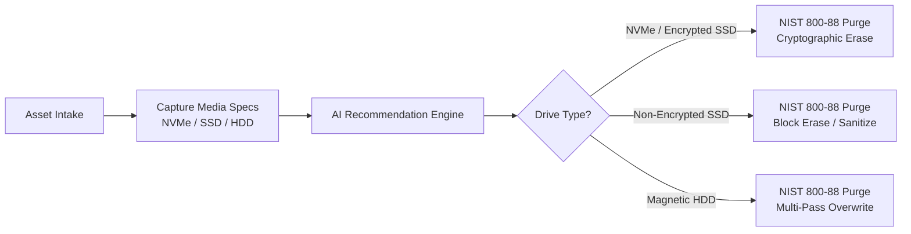
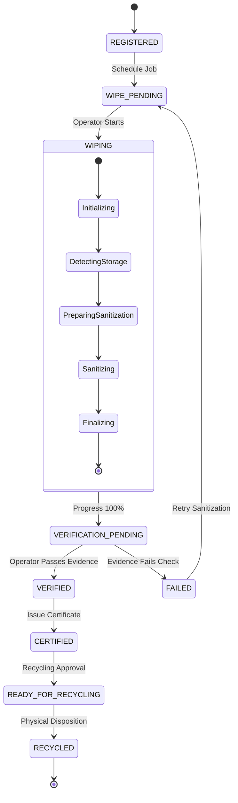

# ZEROTrace AI

> **Secure Data Wiping and Trustworthy IT Asset Recycling Platform**  
> *Secure • Verify • Prove • Recycle*

[](https://github.com/rajivsharma8757/ZEROTrace-AI/actions/workflows/ci.yml)
[](https://opensource.org/licenses/MIT)
[](https://www.typescriptlang.org/)
[](https://react.dev/)
[](https://vitejs.dev/)
[](https://tailwindcss.com/)
[](#sih-project-context)

---

> [!IMPORTANT]
> **Prototype & Simulation Notice:**  
> ZEROTrace AI is currently implemented as an interactive **Control Plane Prototype** designed for Smart India Hackathon evaluation, workflow demonstration, and architectural validation.  
> The web application **does not execute raw physical disk-wiping commands**. All sanitization cycles, progress metrics, and verification telemetry in this release are **simulated client-side** to ensure complete host safety during demonstrations. Real hardware sanitization is architected for Phase 2 via an isolated native local agent daemon.

---

## 1. Project Overview

**ZEROTrace AI** is a specialized cybersecurity and circular-IT governance platform designed to bring verifiable trust, media-appropriate sanitization, and cryptographic accountability to end-of-life IT asset recycling.

By replacing blind "delete and format" practices with a NIST SP 800-88 compliant workflow, ZEROTrace AI bridges the critical trust gap between hardware decommissioning and authorized e-waste recycling or refurbishment.

```
       ┌─────────────────────────────────────────────────────────────┐
       │                       ZEROTrace AI                          │
       │           Secure • Verify • Prove • Recycle                 │
       └──────────────────────────────┬──────────────────────────────┘
                                      │
        ┌──────────────┬──────────────┴──────────────┬──────────────┐
        ▼              ▼                             ▼              ▼
   [Register]    [AI Guidance]                  [Verify]        [Certify]
   Asset Intake   NIST 800-88 Heuristic        Sampled Reads    Tamper-Evident
   & Inventory    Media Capabilities           Key Check        Certificate & QR
```

---

## 2. Problem Statement & Motivation

- **The Fallacy of Formatting:** Standard operating system formatting only clears pointer tables (MFT/inodes), leaving over 99% of user data intact and recoverable using free forensic software.
- **The Solid-State Dilemma:** Legacy magnetic overwrite methods (e.g. DoD 5220.22-M 7-pass) are ineffective on SSDs and NVMe storage due to wear leveling and over-provisioned blocks, and cause severe flash memory degradation. Solid-state media requires firmware-level Purge commands (ATA Secure Erase, NVMe Format/Sanitize, or Cryptographic Erase).
- **The E-Waste Crisis:** Fear of residual data liability causes enterprises to shred functional computers that could otherwise be refurbished, contributing to global e-waste (62 Mt generated in 2022, rising to 82 Mt by 2030; *UN/ITU Global E-waste Monitor 2024*).
- **Regulatory Demands:** India's *E-Waste (Management) Rules, 2022* (CPCB/MoEFCC) mandate strict chain-of-custody tracking and environmentally sound disposal records.

---

## 3. Proposed Solution

ZEROTrace AI establishes an unbroken, digital **Trust Loop**:
1. **Intake & Asset Identity:** Centralized tracking of asset tags, drive interface (NVMe/SSD/HDD), capacity, and encryption status.
2. **Media-Aware AI Guidance:** Automated heuristics recommending NIST SP 800-88 Rev. 2 compliant sanitization methods, security levels, and duration estimates.
3. **Simulated Control Plane Orchestration:** A step-by-step visual control center managing sanitization phases safely.
4. **Independent Evidence Verification:** Hard requirement that evidence (sector sampling and cryptographic key destruction) be reviewed and approved as `PASS` before certification is unlocked.
5. **Tamper-Evident Certification:** Issuance of digital erasure certificates bearing cryptographic hashes and public verification links.
6. **Unauthenticated Public QR Verification:** Instant third-party verification via `/verify/:certificateId` for secondary buyers and recyclers.
7. **Tamper-Evident Audit Trail:** Event ledger chaining previous and current hashes (`previousHash` -> `currentHash`).
8. **Recycling Authorization Gate:** Strict policy enforcement preventing uncertified or unverified assets from being released for e-waste recycling.

---

## 4. Current Implementation Status

| Capability / Module | Current Implementation | Execution Mode | Production Roadmap |
| :--- | :--- | :--- | :--- |
| **Frontend UI** | React 19 + TypeScript + Tailwind + shadcn/ui | Production-grade code | Production Web App |
| **Role Portals** | Admin, Operator, Customer Portals | Client-side routing guards | Backend JWT + RBAC |
| **Persistence** | Browser `localStorage` (`zerotrace-ai-prototype-v1`) | In-browser state | PostgreSQL + Prisma ORM |
| **AI Recommendation** | Deterministic NIST 800-88 Heuristic Engine | Client-side logic | Fine-tuned ML decision model |
| **Sanitization Engine** | 6-phase state machine simulation | Safe visual demo | Native OS daemon (`nvme-cli`, `hdparm`) |
| **Verification Gate** | Operator Pass / Fail decision queue | Interactive review | Automated sector sampling daemon |
| **Certificates** | Unique ID, hash, QR visual, `.txt` download | Printable / Text Blob | Asymmetric Ed25519 signed PDF |
| **Public QR Lookup** | Unauthenticated `/verify/:id` route | Client-side verification | Cloud-hosted registry |
| **Audit Log** | FNV-1a hash chain | In-memory / localStorage | SHA-256 Merkle Tree / Ledger |

---

## 5. Technology Stack

- **Frontend Framework:** React `19.2.3` with TypeScript `5.5.3`
- **Build Tooling:** Vite `8.0.0` with `@vitejs/plugin-react-swc`
- **Styling & Design:** Tailwind CSS `3.4.11` (dark cybersecurity theme)
- **UI Primitives:** shadcn/ui configured with Radix UI primitives (`@radix-ui/react-*`)
- **Iconography:** Lucide React (`0.462.0`)
- **Routing:** React Router DOM `6.30.4`
- **Data & State Management:** `@tanstack/react-query` `5.56.2` + custom `useAppData()` reactive hook
- **Feedback & Alerts:** Sonner `1.5.0` & Radix Toast
- **Charting:** Recharts `2.12.7`

---

## 6. System Architecture

ZEROTrace AI divides its operations into three distinct planes:

```mermaid
graph TD
    subgraph Control Plane ["1. Control Plane (Governance & Orchestration)"]
        UI["Web Dashboard (React 19 / TypeScript)"]
        RBAC["Role-Based Access Control (Admin, Operator, Customer)"]
        DB[("State Persistence (localStorage / Future PostgreSQL)")]
        UI --> RBAC --> DB
    end

    subgraph Execution Plane ["2. Execution Plane (Sanitization Engine)"]
        Sim["Simulation Engine (Current Prototype)"]
        Agent["Local OS Sanitization Agent (Future Phase 2)"]
        Storage["Target Storage Device (NVMe / SSD / HDD)"]
        Sim -.->|Safe Simulated Phases| UI
        Agent -->|NIST 800-88 Purge/Clear| Storage
    end

    subgraph Evidence Plane ["3. Evidence Plane (Verification & Proof)"]
        VerQueue["Evidence Review & Sampling Queue"]
        CertEngine["Certificate Generation & Hash Chain"]
        PublicEndpoint["Public QR Verification Portal (/verify/:id)"]
        VerQueue --> CertEngine --> PublicEndpoint
    end

    Control Plane <--> Execution Plane
    Execution Plane --> Evidence Plane
```

---

## 7. Role-Based Portals

The application provides three tailored experiences based on user identity:

1. **Administrator (`admin@zerotrace.demo` / Avery Morgan):**
   - System-wide executive metrics (total devices, active jobs, certified counts, recycling pipeline).
   - Full device inventory management and asset registration.
   - Authority to issue and revoke digital certificates.
   - Access to the tamper-evident audit trail and system settings.
   - Authorization authority for downstream IT asset recycling.
2. **Employee / Operator (`operator@zerotrace.demo` / Riley Patel):**
   - Operator command center showing assigned devices and pending wipe workloads.
   - Device registration and AI recommendation inspection.
   - Starting and advancing simulated sanitization jobs.
   - Evidence review queue to record Pass/Fail verification decisions.
3. **Customer (`customer@zerotrace.demo` / Jordan Lee):**
   - Strict tenant isolation: Customers can **only** view hardware and certificates linked to their account.
   - Real-time status tracking (Wiping, Verified, Certified, Ready for Recycling).
   - Downloading certificate records and opening public QR verification links.
   - Strictly gated from administrative dashboards and internal audit logs.

---

## 8. Core Workflows

### A. Device Registration & Media-Aware AI Recommendation


### B. Sanitization, Verification, and Certification Lifecycle


---

## 9. Repository Structure

```
zero-trace-ai/
├── .github/
│   ├── ISSUE_TEMPLATE/     # GitHub bug report & feature request templates
│   ├── workflows/          # GitHub Actions CI workflow (typecheck + build)
│   └── pull_request_template.md
├── docs/                   # Full engineering & SIH documentation pack
│   ├── PROJECT_OVERVIEW.md
│   ├── PROBLEM_STATEMENT.md
│   ├── SOLUTION_ARCHITECTURE.md
│   ├── FEATURES.md
│   ├── TECHNICAL_ARCHITECTURE.md
│   ├── DATABASE_AND_DATA_MODEL.md
│   ├── API_DOCUMENTATION.md
│   ├── SECURITY_AND_THREAT_MODEL.md
│   ├── TESTING.md
│   ├── INSTALLATION_AND_SETUP.md
│   ├── DEPLOYMENT.md
│   ├── SIH_DEMO_GUIDE.md
│   ├── SIH_PRESENTATION_OUTLINE.md
│   ├── ROADMAP.md
│   ├── KNOWN_LIMITATIONS.md
│   ├── DECISIONS.md
│   ├── SCREENSHOTS_GUIDE.md
│   └── GITHUB_PUBLISH_CHECKLIST.md
├── public/                 # Static web assets
├── src/
│   ├── components/         # Navigation, app shell, and 50+ shadcn/ui components
│   ├── hooks/              # Custom reactive hooks (useAppData, useMobile, useToast)
│   ├── lib/                # AuthContext, mock database, models, utility functions
│   ├── pages/              # Portal pages (Login, Dashboard, Devices, WipeJobs, etc.)
│   ├── App.tsx             # Route declarations with <Protected> guards
│   ├── globals.css         # Tailwind directives & CSS variables
│   └── main.tsx            # Application entry point
├── .env.example            # Configuration placeholders (no secrets)
├── .gitignore              # Gitignore protecting secrets, dist, and node_modules
├── CHANGELOG.md            # Release history
├── CONTRIBUTING.md         # Contribution guidelines
├── LICENSE                 # MIT License
├── package.json            # Scripts & dependencies
├── README.md               # Primary project documentation
├── tailwind.config.ts      # Tailwind design tokens
├── tsconfig.json           # TypeScript configuration
├── vercel.json             # SPA fallback rewrites for hosting
└── vite.config.ts          # Vite bundler configuration
```

---

## 10. Prerequisites & Environment

- **Node.js:** `v18.0.0` or higher (tested on Node `v24.19.0`)
- **Package Manager:** `npm` `v9.0.0`+ (tested on npm `11.17.0`) or `pnpm`
- **Git:** `v2.40.0` or higher
- **Supported OS:** Windows 10/11, macOS, Linux

---

## 11. Installation & Local Development

### 1. Clone or Open the Project
```bash
git clone https://github.com/rajivsharma8757/ZEROTrace-AI.git
cd ZEROTrace-AI
```

### 2. Install Dependencies
```bash
npm install
```

### 3. Start Development Server
```bash
npm run dev
```
Open your browser and navigate to:
```
http://localhost:8080
```

---

## 12. Validation & Build Commands

All scripts have been verified and tested:

- **Typecheck:**
  ```bash
  npx tsc --noEmit
  ```
  *(Verified: Exit code 0, zero type errors)*

- **Production Build:**
  ```bash
  npm run build
  ```
  *(Verified: Exit code 0, outputs optimized bundle to `dist/` in ~23s)*

- **Lint:**
  ```bash
  npm run lint
  ```

- **Preview Production Build:**
  ```bash
  npm run preview
  ```

---

## 13. Demo Login Credentials

The application includes pre-configured personas accessible directly from the `/login` screen:

| Role | Demo Email | Persona | Key Responsibilities |
| :--- | :--- | :--- | :--- |
| **Administrator** | `admin@zerotrace.demo` | Avery Morgan | Executive metrics, certificate issuance/revocation, audit trail, recycling release |
| **Employee / Operator** | `operator@zerotrace.demo` | Riley Patel | Asset intake, simulated wiping, evidence verification |
| **Customer** | `customer@zerotrace.demo` | Jordan Lee | Customer workspace, viewing owned devices and certificates, public QR links |

---

## 14. Data Persistence & Demo Reset

- **Storage Location:** All state is persisted in the browser's `localStorage` under key `zerotrace-ai-prototype-v1`.
- **Deterministic Seeding:** If storage is empty, an enterprise seed dataset representing **Apex Technology Group** is automatically loaded.
- **How to Reset:**
  1. Log in as **Administrator** (`admin@zerotrace.demo`).
  2. Navigate to **Settings** in the sidebar.
  3. Click **Reset demo data**.
  4. The database resets to seed records, and you are returned to `/login`.

---

## 15. API Documentation Status

> **NOTE:** The current release operates as a client-side Single Page Application. There is **no backend server or live HTTP API** in this release.
> Complete specifications for the target REST API endpoints (Phase 2 roadmap) are documented in [`docs/API_DOCUMENTATION.md`](docs/API_DOCUMENTATION.md).

---

## 16. Visual Walkthrough & Screenshots

Captures of the live platform in action:

| Screen | Description | Placeholder Reference |
| :--- | :--- | :--- |
| **Login Portal** | Multi-role demo selector | `docs/screenshots/01_login_portal.png` |
| **Admin Dashboard** | Executive metrics & status distribution | `docs/screenshots/02_admin_dashboard.png` |
| **Operator Workspace** | Assigned device queue & active jobs | `docs/screenshots/03_operator_workspace.png` |
| **Device Inventory** | Hardware intake table & AI recommendation pane | `docs/screenshots/04_device_inventory.png` |
| **Wipe Simulation** | 6-phase simulated progress orchestrator | `docs/screenshots/06_simulated_wipe_progress.png` |
| **Verification Queue** | Post-wipe sector review & Pass/Fail decisions | `docs/screenshots/07_verification_queue.png` |
| **Digital Certificate** | Issued certificate with unique ID, hash & QR | `docs/screenshots/08_digital_certificate_view.png` |
| **Public QR Lookup** | Unauthenticated verification page (`/verify/:id`) | `docs/screenshots/09_public_qr_verification.png` |
| **Audit Trail** | Tamper-evident hash chain (`previousHash` -> `currentHash`) | `docs/screenshots/10_tamper_evident_audit_trail.png` |
| **Recycling Approval** | Precondition-gated release for circular IT | `docs/screenshots/11_recycling_approval_gate.png` |

*(See [`docs/SCREENSHOTS_GUIDE.md`](docs/SCREENSHOTS_GUIDE.md) for full capture instructions).*

---

## 17. Security & Threat Model Considerations

- **Client-Side Simulation:** The prototype runs safely in a standard browser sandbox. It intentionally has **no access to disk block devices or kernel APIs**.
- **Hash-Chain Realism:** The current hash chain uses an FNV-1a 32-bit algorithm (`ZT-xxxxxxxx`). It is intended to illustrate the data structure of an event ledger and is **not an immutable cryptographic proof**. Production will use SHA-256 HMAC and Merkle trees.
- **Client-Side Routing Guards:** Role gating in this prototype is client-side. Production requires backend API token validation.
- *(See [`docs/SECURITY_AND_THREAT_MODEL.md`](docs/SECURITY_AND_THREAT_MODEL.md) for full STRIDE threat analysis).*

---

## 18. SIH Project Context

- **Event:** Smart India Hackathon (SIH) 2026
- **Problem Statement ID:** `SIH25070`
- **Problem Statement Title:** *Secure Data Wiping for Trustworthy IT Asset Recycling*
- **Theme:** Cybersecurity / Sustainable IT
- **Category:** Software
- **Team Name:** ZeroTrace
- **Standards & Guidance Basis:**
  - NIST Special Publication 800-88 Revision 2 (*Guidelines for Media Sanitization*)
  - UN/ITU Global E-waste Monitor (2024)
  - Ministry of Environment, Forest and Climate Change (MoEFCC) / Central Pollution Control Board (CPCB) *E-Waste (Management) Rules, 2022*

---

## 19. Team Information

- **Team Name:** ZeroTrace
- **Team Lead:** *[Insert Student Name / Contact]*
- **Team Members:** *[Insert Member Names]*
- **Institution / University:** *[Insert College / University Name]*
- **Mentor:** *[Insert Faculty / Industry Mentor Name]*

---

## 20. Contributing & License

- **Contributing:** Please read [`CONTRIBUTING.md`](CONTRIBUTING.md) for pull request and coding standards.
- **License:** This project is licensed under the **MIT License** — see [`LICENSE`](LICENSE) for details.
- **Contact:** For questions or hackathon inquiries, open an issue on GitHub or reach out to the project maintainers.
