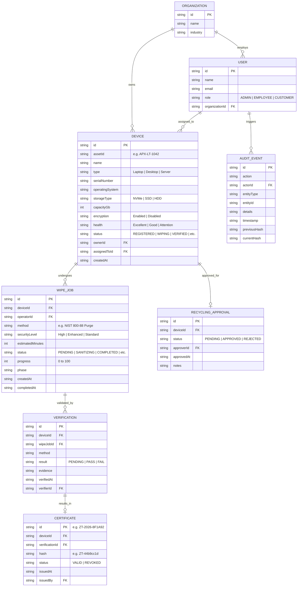

# Database & Data Model — ZEROTrace AI

## Current Implementation: Browser `localStorage` Schema

ZEROTrace AI currently stores its entire domain graph inside a single browser storage key: `zerotrace-ai-prototype-v1`. A secondary key, `zerotrace-user`, stores the active user ID.

### Entity Relationship Diagram (Domain Model)



---

## Seed Dataset Specification

The default deterministic seed dataset represents an enterprise organization (**Apex Technology Group**, `org-zt`):

### Pre-Configured Personas:
1. **Avery Morgan** (`admin@zerotrace.demo` / `usr-admin`): Administrator
2. **Riley Patel** (`operator@zerotrace.demo` / `usr-operator`): Employee / Operator
3. **Jordan Lee** (`customer@zerotrace.demo` / `usr-customer`): Customer

### Pre-Configured Devices:
- `APX-LT-1042` (Latitude 7440, NVMe 512GB, Status: `VERIFIED`, Certificate issued: `ZT-2026-8F1A92`)
- `APX-DT-2088` (OptiPlex 7010, SSD 1024GB, Status: `WIPING`, 58% sanitized)
- `APX-SRV-006` (PowerEdge R650, HDD 4096GB, Status: `READY_FOR_RECYCLING`, Approved by Admin)
- `APX-LT-1099` (MacBook Pro 14, SSD 512GB, Status: `WIPE_PENDING`, Awaiting operator start)

---

## Proposed Production Schema: PostgreSQL (Prisma ORM)

For Phase 2 migration to an external database, the schema maps directly to PostgreSQL:

```prisma
datasource db {
  provider = "postgresql"
  url      = env("DATABASE_URL")
}

generator client {
  provider = "prisma-client-js"
}

enum Role {
  ADMIN
  EMPLOYEE
  CUSTOMER
  AUDITOR
}

enum DeviceStatus {
  REGISTERED
  WIPE_PENDING
  WIPING
  VERIFICATION_PENDING
  VERIFIED
  CERTIFIED
  READY_FOR_RECYCLING
  RECYCLED
  FAILED
}

enum WipeStatus {
  PENDING
  INITIALIZING
  DETECTING_STORAGE
  PREPARING_SANITIZATION
  SANITIZING
  FINALIZING
  VERIFICATION_PREPARATION
  COMPLETED
  FAILED
}

model Organization {
  id        String   @id @default(uuid())
  name      String
  industry  String
  users     User[]
  devices   Device[]
  createdAt DateTime @default(now())
}

model User {
  id             String        @id @default(uuid())
  name           String
  email          String        @unique
  passwordHash   String
  role           Role          @default(CUSTOMER)
  organizationId String
  organization   Organization  @relation(fields: [organizationId], references: [id])
  ownedDevices   Device[]      @relation("DeviceOwner")
  assignedDevices Device[]     @relation("DeviceAssignee")
  auditEvents    AuditEvent[]
  createdAt      DateTime      @default(now())
}

model Device {
  id               String              @id @default(uuid())
  assetId          String              @unique
  name             String
  type             String
  serialNumber     String              @unique
  operatingSystem  String
  storageType      String
  capacityGb       Int
  encryption       String
  health           String
  status           DeviceStatus        @default(REGISTERED)
  organizationId   String
  organization     Organization        @relation(fields: [organizationId], references: [id])
  ownerId          String
  owner            User                @relation("DeviceOwner", fields: [ownerId], references: [id])
  assignedToId     String?
  assignedTo       User?               @relation("DeviceAssignee", fields: [assignedToId], references: [id])
  wipeJobs         WipeJob[]
  verifications    Verification[]
  certificate      Certificate?
  recyclingApproval RecyclingApproval?
  createdAt        DateTime            @default(now())
}

model WipeJob {
  id               String         @id @default(uuid())
  deviceId         String
  device           Device         @relation(fields: [deviceId], references: [id])
  operatorId       String?
  method           String
  securityLevel    String
  estimatedMinutes Int
  status           WipeStatus     @default(PENDING)
  progress         Int            @default(0)
  phase            String
  createdAt        DateTime       @default(now())
  completedAt      DateTime?
  verifications    Verification[]
}

model Verification {
  id          String       @id @default(uuid())
  deviceId    String
  device      Device       @relation(fields: [deviceId], references: [id])
  wipeJobId   String
  wipeJob     WipeJob      @relation(fields: [wipeJobId], references: [id])
  method      String
  result      String       @default("PENDING")
  evidence    String
  verifiedAt  DateTime?
  verifierId  String?
  certificate Certificate?
}

model Certificate {
  id             String       @id
  deviceId       String       @unique
  device         Device       @relation(fields: [deviceId], references: [id])
  verificationId String       @unique
  verification   Verification @relation(fields: [verificationId], references: [id])
  hash           String
  status         String       @default("VALID")
  issuedAt       DateTime     @default(now())
  issuedBy       String
}

model AuditEvent {
  id           String   @id @default(uuid())
  action       String
  actorId      String
  actor        User     @relation(fields: [actorId], references: [id])
  entityType   String
  entityId     String
  details      String
  timestamp    DateTime @default(now())
  previousHash String
  currentHash  String
}

model RecyclingApproval {
  id         String    @id @default(uuid())
  deviceId   String    @unique
  device     Device    @relation(fields: [deviceId], references: [id])
  status     String    @default("PENDING")
  approverId String?
  approvedAt DateTime?
  notes      String
}
```
