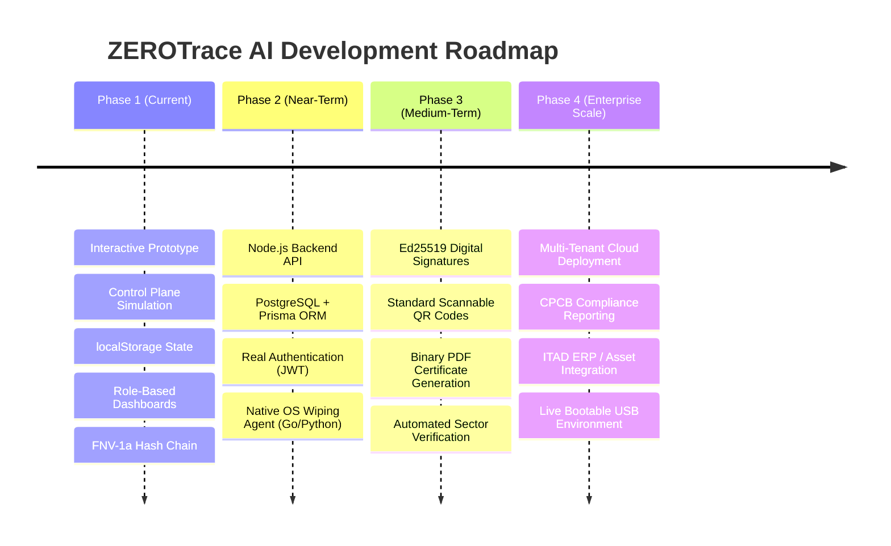

# Implementation Roadmap — ZEROTrace AI

This roadmap outlines the evolution of ZEROTrace AI from the current interactive prototype to a full enterprise-grade data sanitization and recycling compliance platform.

---

## Roadmap Overview

---

## Phase 1: Interactive Prototype & Control Plane (Current Milestone)
- [x] Modern React 19 + TypeScript + Vite + Tailwind CSS + shadcn/ui frontend.
- [x] Three dedicated user portals: Administrator, Employee/Operator, and Customer.
- [x] Device intake and asset metadata management.
- [x] Media-aware AI recommendation heuristic adhering to NIST SP 800-88 Rev. 2.
- [x] 6-stage simulated wipe lifecycle with explicit simulation warning banners.
- [x] Independent verification review queue with operator Pass/Fail controls.
- [x] Tamper-evident digital erasure certificates with unique IDs and hashes.
- [x] Unauthenticated public verification endpoint (`/verify/:certificateId`).
- [x] Event ledger with FNV-1a hash chaining (`previousHash` -> `currentHash`).
- [x] Multi-condition recycling authorization gate.
- [x] Comprehensive technical documentation, SIH demo guide, and presentation outline.

---

## Phase 2: Backend API & Local Sanitization Agent (Target: Q1 2027)
- [ ] **Node.js / Express REST API:**
  - Replace `src/lib/data.ts` with API service calls.
  - Implement JWT authentication with HTTP-only secure cookies and bcrypt/Argon2id password hashing.
- [ ] **PostgreSQL Database:**
  - Implement Prisma ORM schema (as specified in `docs/DATABASE_AND_DATA_MODEL.md`).
  - Add database migrations and row-level security for tenant isolation.
- [ ] **Native Local Sanitization Agent:**
  - Build a lightweight daemon in Go or Python that runs on the technician's workstation.
  - Authenticate agent with the cloud API via mutual TLS (mTLS).
  - Implement target-disk detection and hardware confirmation prompts.
  - Lock out the host OS boot disk to prevent accidental destruction.

---

## Phase 3: Cryptographic Integrity & Advanced Verification (Target: Q2 2027)
- [ ] **Standard ISO/IEC 18004 QR Codes:**
  - Replace the 9x9 CSS visual matrix with real scannable QR codes (`qrcode.react`).
- [ ] **Asymmetric Certificate Signatures:**
  - Implement Ed25519 private key signing for all generated certificates.
  - Public verification route validates the cryptographic signature against the platform's public key.
- [ ] **Cryptographic Hash Chain:**
  - Upgrade FNV-1a hash chain to SHA-256 HMAC or a Merkle Tree ledger.
- [ ] **Direct Binary PDF Generation:**
  - Generate enterprise-grade, printable PDF certificates with watermarks, hashes, and embedded QR codes via `jspdf` or server-side Puppeteer.
- [ ] **Automated Post-Wipe Sector Sampling:**
  - Local agent automatically reads and validates pseudo-random sample sectors (e.g. 5% of total LBAs) to verify zero-fill or random pattern distribution before triggering the verification event.

---

## Phase 4: Enterprise Scale & Compliance (Target: Q3–Q4 2027)
- [ ] **Bootable Live USB Environment:**
  - Create a lightweight Linux ISO (Alpine / Debian Live) bundled with the ZEROTrace agent for bare-metal machine wiping without booting the installed OS.
- [ ] **Regulatory Compliance Reporting:**
  - Automated report generation aligned with India's **E-Waste (Management) Rules, 2022** for submission to the Central Pollution Control Board (CPCB) and State Pollution Control Boards (SPCBs).
- [ ] **Enterprise ITAD Integrations:**
  - REST webhooks and integrations with ServiceNow, Jira Service Management, and enterprise IT Asset Management (ITAM) platforms.
