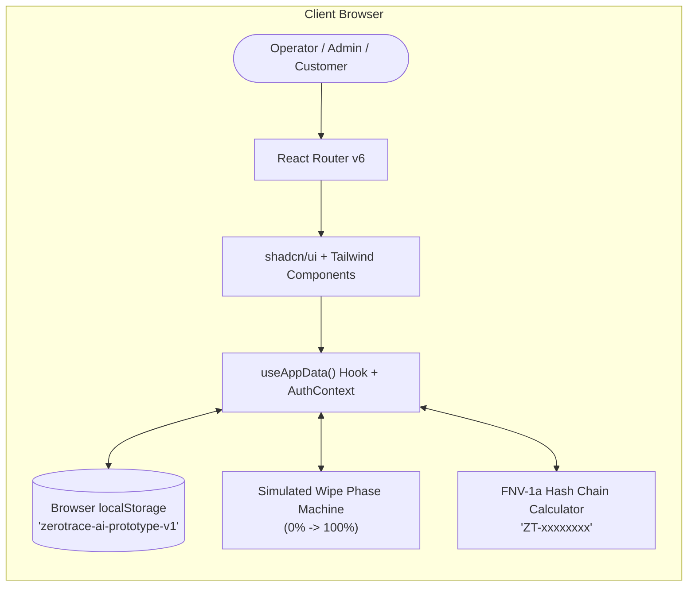
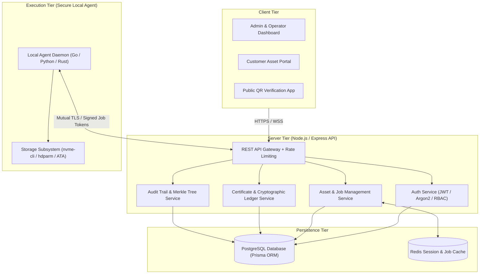
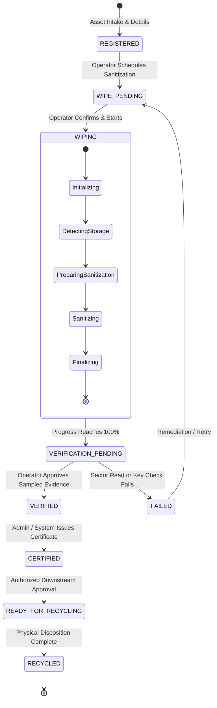

# Solution Architecture — ZEROTrace AI

## System Architectural Planes

ZEROTrace AI separates its architectural responsibilities across three distinct operational planes:

```mermaid
graph TD
    subgraph Control Plane ["1. Control Plane (Governance & Orchestration)"]
        UI["Web Dashboard (React 19 / TypeScript)"]
        RBAC["Role-Based Access Control (Admin, Operator, Customer)"]
        DB[("State Persistence (localStorage / Future PostgreSQL)")]
        UI --> RBAC --> DB
    end

    subgraph Execution Plane ["2. Execution Plane (Sanitization Engine)"]
        Sim["Simulation Engine (Current Prototype)"]
        Agent["Local OS Sanitization Agent (Future Phase 2)"]
        Storage["Target Storage Device (NVMe / SSD / HDD)"]
        Sim -.->|Safe Simulated Phases| UI
        Agent -->|NIST 800-88 Purge/Clear| Storage
    end

    subgraph Evidence Plane ["3. Evidence Plane (Verification & Proof)"]
        VerQueue["Evidence Review & Sampling Queue"]
        CertEngine["Certificate Generation & Hash Chain"]
        PublicEndpoint["Public QR Verification Portal (/verify/:id)"]
        VerQueue --> CertEngine --> PublicEndpoint
    end

    Control Plane <--> Execution Plane
    Execution Plane --> Evidence Plane
```

---

## Current Architecture vs. Proposed Future Architecture

### Current Implemented Architecture (Phase 1 Prototype)

The current implementation is an interactive, browser-based prototype. All storage and state management operate client-side in the browser:



### Proposed Future Production Architecture (Phase 2 & 3 Target)



---

## Device Sanitization Lifecycle State Machine

An asset moves through a strict linear lifecycle where certification and recycling are unreachable without passing verification:



---

## Verification-to-Certificate & Recycling Workflow

```mermaid
sequenceDiagram
    autonumber
    actor Op as Operator (Employee)
    participant UI as Dashboard UI
    participant Data as App State (localStorage)
    actor Admin as Administrator
    actor Cust as Customer / Auditor
    
    Op->>UI: Selects asset & clicks "Start demo wipe"
    UI->>Data: Updates device status to WIPING
    Op->>UI: Advances simulation phases (0% to 100%)
    UI->>Data: Status becomes VERIFICATION_PENDING; creates verification record
    Op->>UI: Reviews simulated sector read evidence & clicks "Pass"
    UI->>Data: Status becomes VERIFIED; logs audit event
    Admin->>UI: Navigates to Certificates & clicks "Issue Certificate"
    UI->>Data: Generates unique Certificate ID + Hash; status becomes CERTIFIED
    Cust->>UI: Scans QR / opens /verify/:certId
    UI-->>Cust: Displays valid certificate proof & device specs without login
    Admin->>UI: Navigates to Recycling & clicks "Approve for Recycling"
    UI->>Data: Records recycling approval; status becomes READY_FOR_RECYCLING
```
