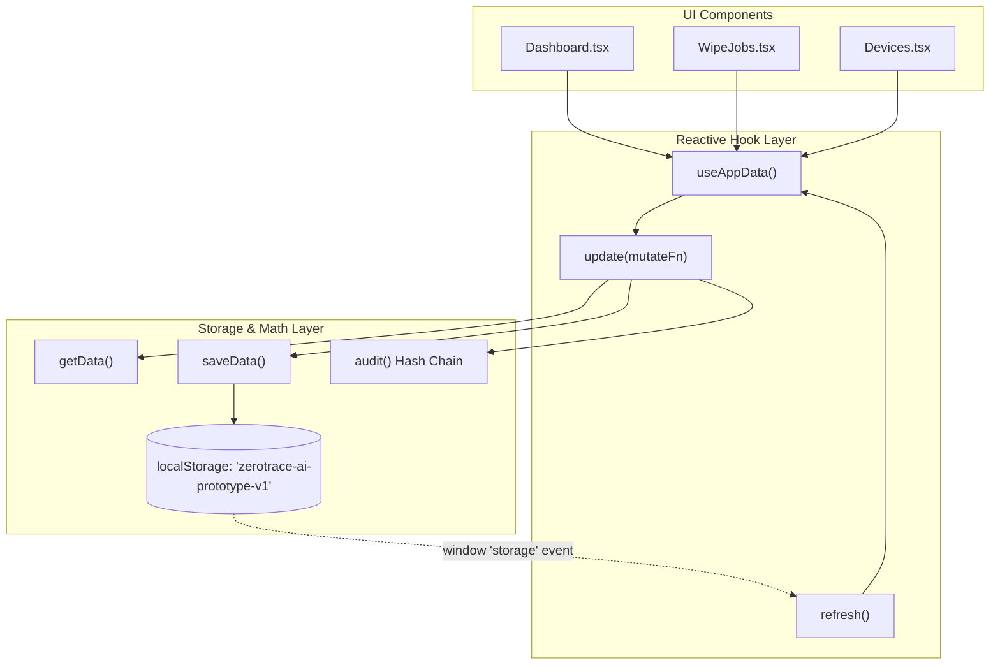

# Technical Architecture — ZEROTrace AI

## Frontend Technology Stack

| Layer | Library / Tool | Version | Purpose |
| :--- | :--- | :--- | :--- |
| **Framework** | React | `19.2.3` | Component-based UI rendering |
| **Language** | TypeScript | `5.5.3` | Static typing, interface contracts |
| **Bundler** | Vite | `8.0.0` | Ultra-fast HMR and production bundling |
| **CSS Engine** | Tailwind CSS | `3.4.11` | Utility-first styling with dark theme |
| **UI Components** | shadcn/ui + Radix UI | Radix Primitives | Accessible UI primitives (dialogs, cards, tables) |
| **Icons** | Lucide React | `0.462.0` | Cybersecurity and operational iconography |
| **Routing** | React Router DOM | `6.30.4` | Client-side routing with role-based guards |
| **State / Cache** | TanStack React Query | `5.56.2` | Async state management & caching |
| **Notifications** | Sonner | `1.5.0` | Toast feedback notifications |
| **Charts** | Recharts | `2.12.7` | Asset lifecycle & distribution charting |

---

## Directory Structure & Code Organization

```
zero-trace-ai/
├── public/                 # Static public assets
├── src/
│   ├── components/         # Reusable application components
│   │   ├── ui/             # 50+ shadcn/ui components (card, dialog, button, etc.)
│   │   ├── app-shell.tsx   # Responsive layout with role-aware sidebar & header
│   │   ├── shared.tsx      # PageHeader, StatusBadge, EmptyState, IconForStatus
│   │   └── made-with-dyad.tsx # Origin badge (scaffolding credit)
│   ├── hooks/
│   │   ├── use-app-data.ts # Reactive hook syncing state across tabs & localStorage
│   │   ├── use-mobile.tsx  # Viewport width detection for responsive drawer
│   │   └── use-toast.ts    # Toast messaging hook
│   ├── lib/
│   │   ├── auth.tsx        # AuthContext provider, role state, login/logout logic
│   │   ├── data.ts         # In-memory seed, localStorage sync, hash chain & AI logic
│   │   ├── models.ts       # TypeScript interfaces (Device, WipeJob, Certificate, etc.)
│   │   └── utils.ts        # cn() class merging utility (clsx + tailwind-merge)
│   ├── pages/
│   │   ├── Login.tsx       # Multi-role demo login portal
│   │   ├── Dashboard.tsx   # Role-adapted dashboard (Admin, Operator, Customer)
│   │   ├── Devices.tsx     # Asset registration modal & inventory management
│   │   ├── WipeJobs.tsx    # Multi-phase simulated wipe orchestrator
│   │   ├── Verification.tsx# Post-wipe evidence review and Pass/Fail decisions
│   │   ├── Certificates.tsx# Certificate generation, QR visual, download & revocation
│   │   ├── PublicVerify.tsx# Unauthenticated public QR verification portal
│   │   ├── AuditLog.tsx    # Tamper-evident hash chain audit trail
│   │   ├── Recycling.tsx   # Downstream recycling approval gate
│   │   ├── SettingsProfile.tsx # Demo data reset & user profile views
│   │   ├── Index.tsx       # Legacy fallback route (redirects to /login)
│   │   └── NotFound.tsx    # 404 handler
│   ├── App.tsx             # Root application routes with <Protected> guards
│   ├── globals.css         # Tailwind directives and CSS color variables
│   └── main.tsx            # React DOM root entry point
├── components.json         # shadcn/ui configuration
├── tailwind.config.ts      # Tailwind color tokens & animations
├── tsconfig.json           # TypeScript configuration
├── vercel.json             # SPA fallback rewrites for hosting
└── vite.config.ts          # Vite bundler configuration & @ path alias
```

---

## State Management & Reactivity Pattern

The prototype uses a lightweight, reactive pattern combining React Context, custom hooks, and the browser's `StorageEvent` API:



### Key Implementation Details:
1. **Multi-Tab Synchronization:** `useAppData` attaches a listener to the `window.storage` event. If an operator updates a device in one browser tab, other open tabs immediately refresh their view.
2. **Atomic In-Memory Mutation:** Mutations pass an updater function `mutate: (data: AppData) => void` that clones current state, applies modifications, calculates the audit hash, and commits back to `localStorage`.
3. **Deterministic Seeding:** When `localStorage` is empty (or after clicking **Reset demo data** in Settings), `src/lib/data.ts` rehydrates an enterprise seed dataset (`Apex Technology Group`).

---

## Routing & Role Protection Architecture

Routing is managed via `react-router-dom` in `src/App.tsx`:

```tsx
function Protected({ children, roles }: { children: ReactNode; roles?: Role[] }) {
  const { user } = useAuth();
  if (!user) return <Navigate to="/login" replace />;
  if (roles && !roles.includes(user.role)) return <Navigate to={homeFor(user.role)} replace />;
  return <AppShell>{children}</AppShell>;
}
```

- Unauthorized users visiting protected pages are redirected to `/login`.
- Authenticated users attempting to access routes outside their role privileges are automatically redirected to their designated home dashboard (`/admin-dashboard`, `/employee-dashboard`, or `/customer-dashboard`).
- The `/verify/:certificateId` route is deliberately placed **outside** the `<Protected>` wrapper to allow unauthenticated public verification.
